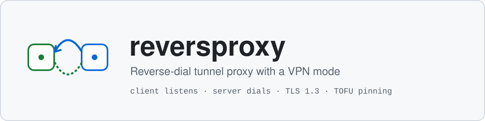
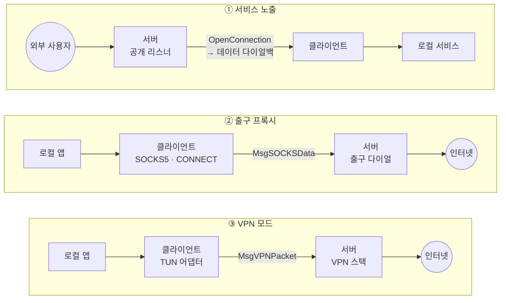
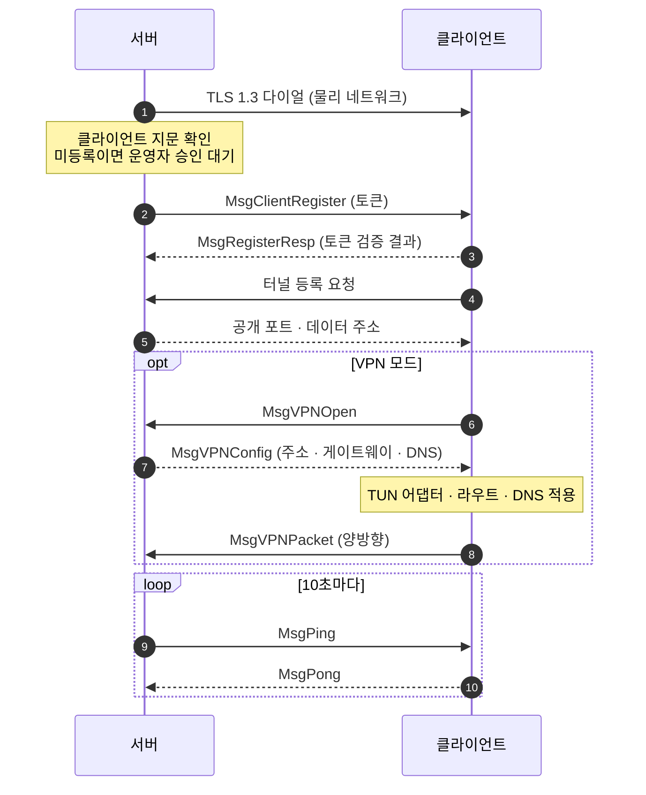
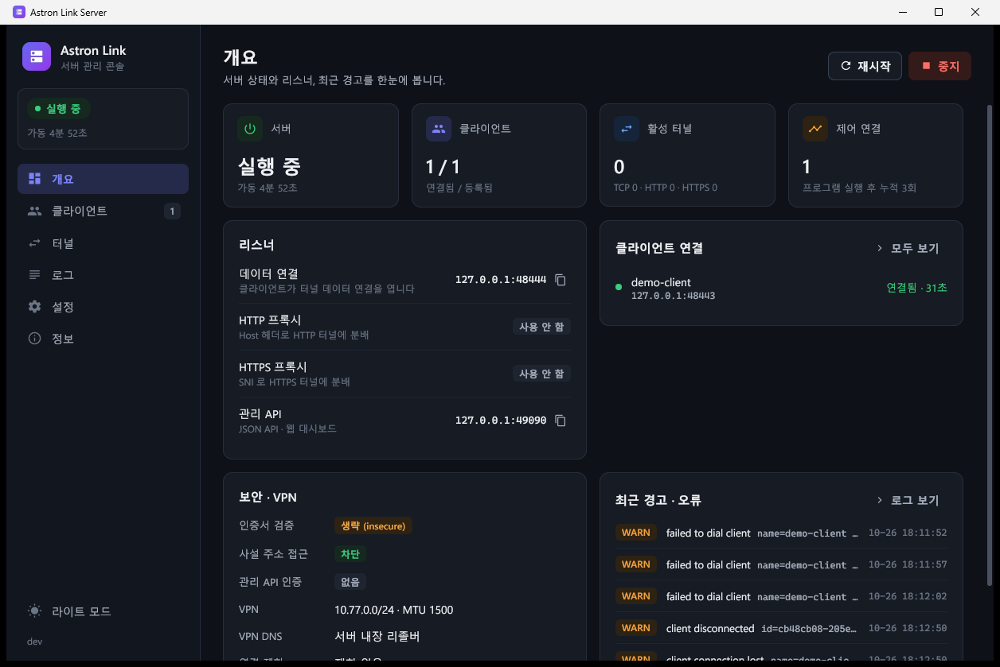
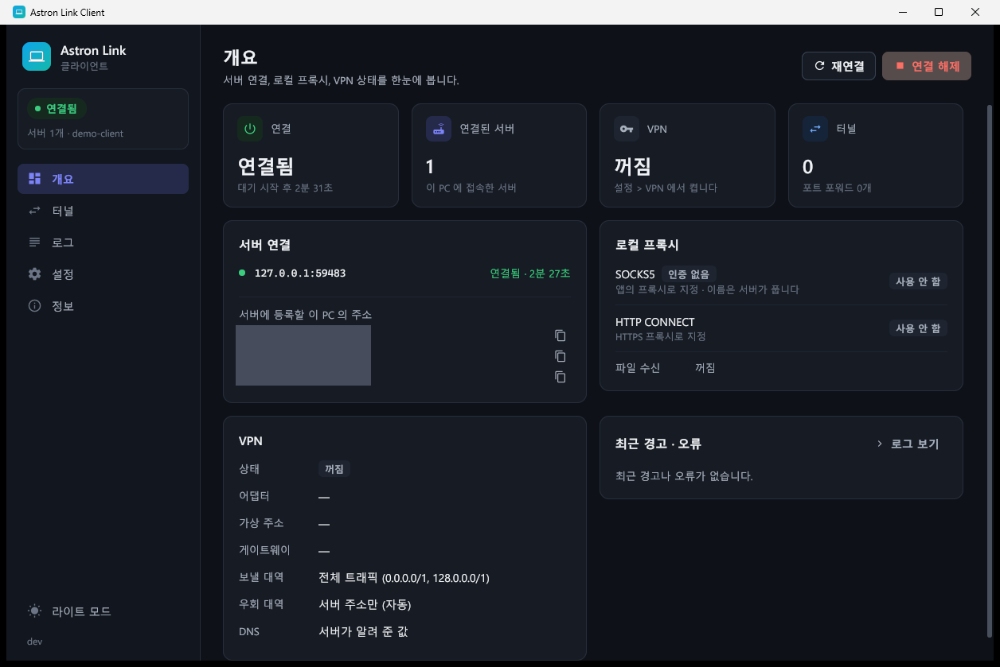
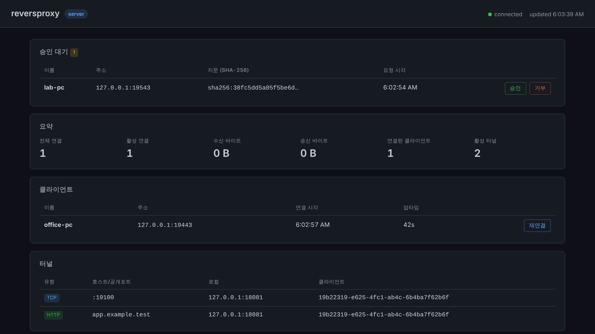

<p align="center">
  <picture>
    <source media="(prefers-color-scheme: dark)" srcset="docs/assets/banner-dark.svg">
    
  </picture>
</p>

<p align="center">
  <a href="https://github.com/AstronWorks/AstronLink/actions/workflows/release.yml"></a>
  <a href="https://github.com/AstronWorks/AstronLink/releases/latest"></a>
  
  
  
  
  <a href="LICENSE"></a>
</p>

<p align="center"><b>NAT·방화벽 뒤의 클라이언트가 리슨하고 공인 서버가 다이얼해 들어오는 Go 역방향 터널 프록시입니다.<br>서비스 노출, 출구 프록시(SOCKS5·HTTP CONNECT), VPN 모드를 TLS 제어 연결 하나를 중심으로 제공합니다.</b></p>

- 🔁 **역방향 연결** — 클라이언트가 TLS 1.3 리스너를 열고, 서버가 각 클라이언트로 다이얼합니다. 제어 연결은 서버 → 클라이언트 방향입니다.
- 🌐 **서비스 노출** — 서버의 TCP 포트·HTTP `Host`·HTTPS SNI로 들어온 요청을 클라이언트의 로컬 서비스로 전달합니다.
- 🛡️ **VPN 모드** — 핸드셰이크 뒤 클라이언트의 가상 네트워크 어댑터(TUN) 트래픽을 서버가 출구 노드로 처리합니다. 서버에는 권한·TUN·NAT 설정이 필요 없습니다.
- 🔐 **TOFU 승인** — 클라이언트 인증서 지문을 고정하고, 처음 보는 클라이언트는 운영자가 승인할 때까지 차단합니다.

---

## 목차

- [기능](#기능)
- [아키텍처](#아키텍처)
- [동작 흐름](#동작-흐름)
- [화면](#화면)
- [빠른 시작](#빠른-시작)
- [설치](#설치)
- [VPN 모드](#vpn-모드)
- [출구 프록시](#출구-프록시)
- [설정](#설정)
- [포트](#포트)
- [관리 API와 대시보드](#관리-api와-대시보드)
- [보안](#보안)
- [성능 측정](#성능-측정)
- [빌드와 테스트](#빌드와-테스트)
- [프로젝트 구조](#프로젝트-구조)
- [알려진 제한](#알려진-제한)
- [문서](#문서)
- [라이선스](#라이선스)

## 기능

| | 기능 | 설명 | 설정 |
|:-:|------|------|------|
| 🔁 | 역방향 제어 연결 | 서버가 `clients[].address` 로 TLS 1.3 다이얼, 끊기면 지수 백오프(1초 → 60초, ±20% 지터)로 재다이얼 | `clients` |
| 🚪 | TCP 터널 | 서버 공개 포트 → 클라이언트 로컬 서비스. 외부 연결마다 클라이언트가 데이터 연결을 다이얼백 | `tunnels[].type: tcp` |
| 🏷️ | HTTP Host 라우팅 | `Host` 헤더로 클라이언트를 고르고 원본 요청 바이트를 그대로 전달 | `http_addr`, `type: http` |
| 🔒 | HTTPS SNI 라우팅 | TLS ClientHello 의 SNI 로 라우팅, TLS 는 클라이언트의 로컬 서비스에서 종료 | `https_addr`, `type: https` |
| 🧦 | SOCKS5 | CONNECT 전용, 사용자명/비밀번호 인증(RFC 1929) 선택 | `socks_addr`, `socks_user`, `socks_pass` |
| 🔌 | HTTP CONNECT | `HTTPS_PROXY` 로 쓰는 로컬 프록시 (인증 없음) | `http_proxy_addr` |
| ↪️ | 포트 포워드 | 로컬 포트 → 서버 경유 → 고정 대상 (예: RDP) | `port_forwards` |
| 🛡️ | VPN 모드 | 클라이언트 TUN 어댑터 ↔ 서버 유저스페이스 TCP/IP 스택 (TCP·UDP·DNS) | `vpn` |
| 🔐 | TOFU 지문 고정 | `known_hosts.yaml` 에 지문 기록, 미등록은 운영자 승인 대기, 불일치는 거부 | `known_hosts_path`, `auto_approve` |
| 🧯 | SSRF 가드 | 출구 다이얼에서 루프백·사설·링크로컬·멀티캐스트 주소 차단 | `allow_private_targets` |
| 📊 | 대시보드·API | 서버에 임베드된 웹 UI, REST·SSE 엔드포인트 8개 | `admin_addr`, `admin_token` |
| 🚦 | 레이트 리밋 | IP별 토큰 버킷 + 전역 동시 연결 상한 (HTTP/HTTPS 프록시) | `max_conn_rate`, `max_conn_burst`, `max_concurrent` |
| 📁 | 파일 전송 | 드롭 폴더 수신 + CLI·탐색기 우클릭 송신, 이어받기, SHA-256 검증 | `file_transfer` → [FILE_TRANSFER.md](FILE_TRANSFER.md) |
| 🖥️ | Windows GUI | 트레이 클라이언트(관리 콘솔·설정 창), 트레이 서버(네이티브 관리 콘솔) | `cmd/winclient`, `cmd/winserver` |

## 아키텍처



세 경로 모두 서버가 클라이언트로 다이얼해 맺은 **TLS 1.3 제어 연결** 위에서 동작합니다. 노출 경로의 데이터만 연결마다 별도로 다이얼백합니다.

- **제어 평면**: 서버 → 클라이언트 다이얼(클라이언트 `:8443`). 클라이언트가 TLS 서버 역할(인증서 제시), 서버가 TLS 클라이언트 역할(지문 고정)을 합니다.
- **노출 경로**: 외부 연결이 오면 서버가 `MsgOpenConnection` 을 보내고, 클라이언트가 서버의 데이터 포트로 새 연결을 다이얼백합니다. 연결마다 일회용 토큰(`DataToken`)을 확인합니다.
- **출구 경로**: SOCKS5·HTTP CONNECT·포트 포워드 스트림과 VPN 패킷은 모두 기존 제어 연결 위에서 멀티플렉싱됩니다. 대상 다이얼은 서버가 하며, SOCKS5 도메인 요청과 VPN 게이트웨이 DNS 질의도 서버에서 이름을 해석합니다.

## 동작 흐름



<details>
<summary>단계별 설명</summary>

1. 클라이언트가 `listen_addr`(기본 `:8443`)에서 TLS 1.3 으로 대기하고, 서버가 `clients[]` 의 각 주소로 다이얼합니다.
2. TLS 핸드셰이크 직후 서버가 클라이언트 leaf 인증서의 SHA-256 지문을 클라이언트 **이름** 기준으로 확인합니다.
   - 등록 + 일치 → 진행 / 등록 + 불일치 → 거부(`client.fingerprint_mismatch` 이벤트) 후 재다이얼
   - 미등록 + `auto_approve: true` → 신뢰하고 저장 / 미등록 + `auto_approve: false`(기본) → `client.pending` 이벤트 후 승인까지 대기
3. 서버가 `MsgClientRegister{AuthToken}` 을 먼저 보내고(10초 제한), 클라이언트가 토큰을 검증해 `MsgRegisterResp` 로 답합니다.
4. 클라이언트가 `tunnels[]` 마다 터널을 요청하고, 서버가 공개 포트를 열거나 호스트명을 라우팅 표에 등록합니다.
5. `vpn.enabled: true` 이면 클라이언트가 `MsgVPNOpen` 을 보내고, 서버가 준 주소로 어댑터를 올립니다. 이후 트래픽은 어댑터를 통해 흐릅니다.
6. 서버가 10초마다 `MsgPing` 을 보내고, 마지막 `MsgPong` 후 30초가 넘으면 연결을 끊고 재다이얼합니다.

</details>

## 화면

<p align="center">
  
</p>

<p align="center">
  
</p>

<p align="center">
  
</p>

Windows 에서 실제로 실행한 화면입니다. 위 두 장은 `cmd/winserver`·`cmd/winclient` 의 관리 콘솔이고, 아래는 서버에 임베드된 웹 대시보드입니다. 한 PC 에서 서버 1대와 클라이언트 1대(`demo-client`)를 루프백으로 연결해 2026-10-26 에 캡처했고, 클라이언트 PC 의 IP 주소는 가렸습니다. 대시보드의 수신·송신 바이트는 현재 집계 경로가 연결되어 있지 않아 0 으로 표시됩니다([관리 API와 대시보드](#관리-api와-대시보드) 참고).

## 빠른 시작

한 대의 Linux 머신에서 로컬 서비스(`127.0.0.1:8000`)를 서버 공개 포트 `9000` 으로 노출해 봅니다. Go 1.24 이상, `openssl`, `curl`, `python3` 가 필요합니다.

**1. 빌드**

```bash
git clone https://github.com/AstronWorks/AstronLink.git
cd AstronLink
go build -o astronlink-server ./cmd/server
go build -o astronlink-client ./cmd/client
```

**2. 설정** — 양쪽 `auth_token` 은 같아야 합니다.

```bash
TOKEN=$(openssl rand -hex 16)

cat > client.yaml <<EOF
listen_addr: "127.0.0.1:8443"
auth_token: "$TOKEN"
name: "client1"
tunnels:
  - type: tcp
    local_host: "127.0.0.1"
    local_port: 8000
    requested_port: 9000
EOF

cat > server.yaml <<EOF
auth_token: "$TOKEN"
insecure: true        # 자체 서명 인증서라 CA 검증만 생략, 지문은 TOFU 로 고정
http_addr: ""         # 이 예제에서는 HTTP/HTTPS 라우팅 프록시를 끔
https_addr: ""
clients:
  - name: "client1"
    address: "127.0.0.1:8443"
EOF
```

**3. 실행** — 각각 다른 터미널에서 실행합니다.

```bash
python3 -m http.server 8000 --bind 127.0.0.1           # 노출할 로컬 서비스
./astronlink-client --config client.yaml              # 클라이언트: 리슨하며 대기
./astronlink-server --config server.yaml              # 서버: 클라이언트로 다이얼
```

**4. 승인과 확인** — 처음 보는 클라이언트는 승인 전까지 차단됩니다.

```bash
curl -X POST "http://127.0.0.1:9090/api/decide?name=client1&action=approve"
curl -s -o /dev/null -w "%{http_code}\n" http://127.0.0.1:9000/    # 200
```

다른 머신에 배포할 때는 `client.yaml` 의 `listen_addr` 를 `":8443"` 로, `server.yaml` 의 `address` 를 `"<클라이언트 IP>:8443"` 로 바꾸고, 클라이언트 측 방화벽에서 8443 인바운드를 허용합니다.

## 설치

릴리스 워크플로(`.github/workflows/release.yml`)가 `v*` 태그마다 아래 7종을 크로스 컴파일(CGO 없음)해 [Releases](https://github.com/AstronWorks/AstronLink/releases/latest) 에 올립니다.

| 파일 | 대상 | 형태 |
|------|------|------|
| `astronlink-client-linux-amd64` | Linux 클라이언트 | CLI (`cmd/client`) |
| `astronlink-client-linux-arm64` | Linux 클라이언트 | CLI (`cmd/client`) |
| `astronlink-client-windows-amd64.exe` | Windows 클라이언트 | 트레이 GUI (`cmd/winclient`) |
| `astronlink-server-linux-amd64` | Linux 서버 | CLI (`cmd/server`) |
| `astronlink-server-linux-arm64` | Linux 서버 | CLI (`cmd/server`) |
| `astronlink-server-cli-windows-amd64.exe` | Windows 서버 | CLI (`cmd/server`) |
| `astronlink-server-windows-amd64.exe` | Windows 서버 | 트레이 GUI (`cmd/winserver`) |

<details>
<summary>설치 스크립트</summary>

**Linux 클라이언트** — `~/astronlink/` 에 바이너리와 `rproxy {start|stop|status|logs|restart}` 헬퍼를 만들고, `~/.bashrc`·`~/.zshrc` 에 `PATH` 와 프록시 환경 변수(`HTTPS_PROXY`·`HTTP_PROXY=http://127.0.0.1:8080`, `ALL_PROXY=socks5h://127.0.0.1:1080`, `NO_PROXY=localhost,127.0.0.1`)를 추가합니다. `rproxy` 의 토큰은 `changeme` 로 들어가므로 실행 전에 바꾸십시오.

```bash
curl -fsSL https://raw.githubusercontent.com/AstronWorks/AstronLink/master/scripts/install-client.sh | bash
```

**Windows 클라이언트 (일반 사용자 권한)** — `%LOCALAPPDATA%\astronlink` 에 트레이 클라이언트와 기본 `config.yaml` 을 설치하고, 로그온 자동 시작(HKCU Run), 탐색기 우클릭 "파일 전송" 메뉴를 등록한 뒤 실행합니다. VPN 모드용 `wintun.dll` 은 WireGuard LLC 서명을 확인한 뒤 함께 설치합니다.

```powershell
irm https://raw.githubusercontent.com/AstronWorks/AstronLink/master/scripts/install-client.ps1 | iex
```

**Windows 서버 (관리자 PowerShell)** — `%ProgramFiles%\astronlink` 에 설치하고, `server.yaml` 을 만들고, 서비스 `astronlink-server` 를 등록(자동 시작, 실패 시 5·10·30초 후 재시작)하며, 8444·8080·8445·9090 인바운드 방화벽 규칙을 추가합니다. 생성되는 `server.yaml` 은 `auth_token: changeme`, `insecure: true` 이므로 운영 전에 바꾸십시오.

```powershell
irm https://raw.githubusercontent.com/AstronWorks/AstronLink/master/scripts/install-server.ps1 | iex
```

**go install**

```bash
go install github.com/AstronWorks/AstronLink/cmd/server@latest
go install github.com/AstronWorks/AstronLink/cmd/client@latest
```

</details>

## VPN 모드

클라이언트가 가상 네트워크 어댑터를 만들고, 애플리케이션 트래픽이 프록시 설정 없이 그 어댑터를 통해 서버로 흐르게 합니다.

1. 연결·TOFU·등록 핸드셰이크는 **기존(물리) 네트워크**에서 그대로 진행합니다.
2. 클라이언트가 `MsgVPNOpen` 을 보내면, 서버가 이 제어 연결 전용 유저스페이스 TCP/IP 스택(gVisor)을 만들고 주소(`10.77.0.2/24`)·게이트웨이(`10.77.0.1`)·MTU·DNS 를 돌려줍니다.
3. 클라이언트가 어댑터에 주소·라우트·DNS 를 적용합니다. 서버 IP 에는 물리 경로 우회 라우트를 넣어 제어 연결은 계속 물리 네트워크를 씁니다.
4. 이후 IP 패킷이 `MsgVPNPacket` 으로 같은 제어 연결을 오가고, 서버 스택이 TCP·UDP 를 종단해 실제 목적지로 다이얼합니다. 게이트웨이 `10.77.0.1:53` 은 서버의 리졸버로 DNS 를 답합니다.
5. 노출 터널의 데이터 다이얼백도 VPN 이 활성인 세션에서는 `10.77.0.1:<data 포트>` 로 어댑터를 거칩니다.

```yaml
# 클라이언트 config.yaml (기본값: 꺼짐)
vpn:
  enabled: true
  routes: []          # 비우면 전체 터널(0.0.0.0/1 + 128.0.0.0/1), 예: ["10.0.0.0/8"]
  bypass: []          # 항상 물리 네트워크로 보낼 대역

# 서버 server.yaml (기본값: 켜짐 — 클라이언트가 요청할 때만 세션 생성)
vpn:
  enabled: true
  subnet: "10.77.0.0/24"
```

| 측 | 요구 사항 |
|----|-----------|
| Linux 클라이언트 | root 또는 `CAP_NET_ADMIN`, `/dev/net/tun`, iproute2. DNS 자동 설정은 `resolvectl` 이 있을 때만 |
| Windows 클라이언트 | 관리자 권한 실행, 실행 파일 옆 `wintun.dll` |
| 서버 | 추가 요구 사항 없음 |

라우팅·DNS·페일오버·보안·제한 사항은 [docs/vpn.md](docs/vpn.md) 에 정리되어 있습니다.

## 출구 프록시

클라이언트 쪽 리스너로 들어온 연결을 서버가 대신 다이얼합니다. 세 리스너 모두 서버 세션 풀을 공유하며, 서버가 여러 대면 요청마다 라운드로빈으로 고릅니다.

| 리스너 | 기본 주소 | 동작 | 서버 없음 |
|--------|-----------|------|-----------|
| SOCKS5 | `127.0.0.1:1080` | CONNECT 만 지원(그 외 명령은 `0x07`), IPv4·도메인·IPv6 주소, `socks_user`·`socks_pass` 둘 다 있으면 인증 | `0x01` 응답 |
| HTTP CONNECT | `127.0.0.1:8080` | `CONNECT` 만 터널링, 다른 메서드엔 안내 문구로 200 응답 | `503` |
| 포트 포워드 | `port_forwards[]` | 로컬 포트 → 고정 `remote_host:remote_port`, `bind` 기본 `127.0.0.1` | 연결 종료 |

```bash
curl -x socks5h://127.0.0.1:1080 https://example.com       # DNS 도 서버에서 해석
HTTPS_PROXY=http://127.0.0.1:8080 curl https://example.com
```

## 설정

설정 파일이 없으면 기본값으로 실행하며, 알 수 없는 YAML 키가 있으면 기동을 거부합니다. 명령줄 플래그는 직접 지정한 것만 설정 파일 값을 덮어씁니다. 전체 키·플래그·상수는 [docs/configuration.md](docs/configuration.md) 를 보십시오.

**서버 핵심 키**

| 키 | 기본값 | 설명 |
|----|--------|------|
| `auth_token` | `""` | 클라이언트와 공유하는 토큰. `insecure: false` 일 때 비어 있거나 `changeme` 면 기동 거부 |
| `insecure` | `false` | 클라이언트 인증서의 CA·호스트명 검증 생략 (TOFU 지문 확인은 그대로) |
| `clients` | 없음 | 다이얼할 클라이언트 `name`·`address`·`auth_token`(비우면 서버 토큰) |
| `auto_approve` | `false` | 미등록 클라이언트를 승인 없이 신뢰 |
| `data_addr` | `:8444` | 데이터 연결 리스너 |
| `http_addr` / `https_addr` | `:8080` / `:8445` | Host / SNI 라우팅 프록시, 빈 값이면 끔 |
| `admin_addr` | `:9090` | 관리 API·대시보드, 호스트를 생략하면 `127.0.0.1` 에 바인딩 |
| `allow_private_targets` | `false` | 출구 다이얼에서 사설·루프백 주소 허용 |
| `vpn` | 켜짐, `10.77.0.0/24` | VPN 모드 서버 설정 |

**클라이언트 핵심 키**

| 키 | 기본값 | 설명 |
|----|--------|------|
| `listen_addr` | `:8443` | 서버가 다이얼해 들어오는 TLS 리스너 |
| `auth_token` | `""` | 서버가 보내는 토큰과 비교 |
| `name` | `client1` | 서버 `clients[].name` 과 같아야 함 (TOFU 키) |
| `tunnels` | 없음 | `type`(`tcp`·`http`·`https`), `local_host`, `local_port`, `requested_port`, `hostname` |
| `socks_addr` / `http_proxy_addr` | `127.0.0.1:1080` / `127.0.0.1:8080` | 출구 프록시 리스너, 빈 값이면 끔 |
| `port_forwards` | 없음 | `local_port`, `remote_host`, `remote_port`, `bind` |
| `vpn` | 꺼짐 | VPN 모드 클라이언트 설정 |

## 포트

| 포트 | 위치 | 용도 | 설정 키 |
|------|------|------|---------|
| `8443` | 클라이언트 | 제어 연결 수신 (서버가 다이얼) | `listen_addr` |
| `8444` | 서버 | 데이터 연결 (노출 경로 다이얼백) | `data_addr` |
| `8080` | 서버 | HTTP Host 라우팅 | `http_addr` |
| `8445` | 서버 | HTTPS SNI 라우팅 | `https_addr` |
| `9090` | 서버 | 관리 API·대시보드 (기본 루프백) | `admin_addr` |
| `requested_port` | 서버 | 터널별 공개 TCP 포트 (`0` 이면 OS 가 할당) | `tunnels[].requested_port` |
| `1080` | 클라이언트 | SOCKS5 (루프백) | `socks_addr` |
| `8080` | 클라이언트 | HTTP CONNECT (루프백) | `http_proxy_addr` |
| `local_port` | 클라이언트 | 포트 포워드 | `port_forwards[].local_port` |

## 관리 API와 대시보드

`admin_addr` 의 HTTP 서버가 대시보드(`/`)와 JSON API, SSE 를 함께 제공합니다. `admin_token` 을 설정하면 `/api/*` 에 `Authorization: Bearer <토큰>` 이 필요합니다. 대시보드 HTML(`/`)과 정적 파일(`/static/`)은 인증하지 않으며, 대시보드는 토큰을 보내지 않으므로 `admin_token` 을 설정하면 대시보드 데이터 호출이 401 로 실패합니다.

| 메서드 | 경로 | 설명 |
|--------|------|------|
| GET | `/api/clients` | 연결된 클라이언트 |
| GET | `/api/tunnels` | 활성 터널 |
| GET | `/api/stats` | 연결 수 통계 |
| GET | `/api/pending` | TOFU 승인 대기 목록 |
| GET · DELETE | `/api/known-hosts` | 신뢰 지문 목록 / `?name=` 지문 철회 |
| POST | `/api/decide?name=&action=approve\|reject` | 승인 또는 거부 |
| POST | `/api/reconnect?name=` | 해당 클라이언트 연결을 끊어 재다이얼 |
| GET | `/api/events` | SSE 이벤트 스트림 |

응답 형식, 이벤트 종류, 알려진 제약은 [docs/admin-api.md](docs/admin-api.md) 에 있습니다.

## 보안

- **기동 차단(fail-closed)**: 서버는 `insecure: false` 에서 `auth_token` 이 비어 있거나 `changeme` 면 시작하지 않습니다.
- **TLS 1.3 고정**: 양쪽 모두 최소 버전이 TLS 1.3 입니다. 인증서가 없으면 자체 서명 인증서(ECDSA P-256, 10년, SAN `127.0.0.1`·`localhost`)를 만듭니다.
- **`insecure` 의 의미**: 서버의 `insecure: true` 는 클라이언트 인증서의 CA·호스트명 검증만 생략하고, 지문은 TOFU 로 고정됩니다. `insecure: false` 로 연결하려면 클라이언트 인증서가 시스템 루트 또는 `client_ca_cert` 로 검증되고 접속 주소와 SAN 이 맞아야 합니다.
- **데이터 연결 인증**: 노출 경로의 데이터 연결은 서버가 발급한 일회용 토큰을 상수 시간 비교로 확인합니다.
- **SSRF 가드**: SOCKS5·HTTP CONNECT·포트 포워드·VPN 출구는 기본적으로 루프백·사설·링크로컬·멀티캐스트·미지정 주소로 다이얼하지 않습니다. 이름 해석 후의 주소로 판정합니다.
- **관리 API**: 호스트 없이 지정한 `admin_addr` 는 `127.0.0.1` 에만 바인딩합니다. 외부에 열 때는 `admin_token` 을 설정하십시오.
- **Windows 트레이 서버 주의**: `cmd/winserver` 는 TOFU 지문 확인·운영자 승인·SSE 이벤트 없이 클라이언트로 다이얼하며, 재다이얼 간격은 5초 고정입니다. 지문 고정이 필요하면 `cmd/server` 를 사용하십시오.

## 성능 측정

제어 연결(루프백) 위에서 8 MiB 를 한 방향으로 올리는 처리량을 직접 TCP, SOCKS5 경로, VPN 경로로 비교하는 벤치마크가 있습니다. 수치는 호스트·CPU 에 따라 크게 달라지므로 문서에 고정하지 않습니다. 사용 중인 환경에서 다음 명령으로 측정하십시오.

```bash
go test -run '^$' -bench BenchmarkUploadThroughput -benchtime 20x -count 3 ./internal/client/
```

VPN 경로는 실제 커널 TUN 대신 gVisor 스택이 클라이언트 OS 역할을 하는 테스트 장치(`internal/vpn/vpntest`)를 거칩니다. 네트워크 지연·손실이 있는 실제 회선 수치가 아닙니다.

## 빌드와 테스트

순수 Go(CGO 없음)이므로 어느 호스트에서나 Linux·Windows 바이너리를 만들 수 있습니다.

| 명령 | 동작 |
|------|------|
| `make build` | `go build ./...` |
| `make test` | `go test -race ./...` |
| `make lint` | `go vet ./...` |
| `make dist` | Linux·Windows 서버/클라이언트/트레이 서버를 `dist/` 에 크로스 컴파일 |
| `./scripts/build.sh` | `dist/` 크로스 빌드 + 릴리스용 이름 사본 (`TARGET_OS`, `ARCH` 로 선택) |
| `./scripts/build.ps1` | Windows PowerShell 용 같은 빌드 (`-Os`, `-Arch` 로 선택) |

```bash
GOOS=windows GOARCH=amd64 CGO_ENABLED=0 go build -ldflags "-H windowsgui -s -w" \
  -o astronlink-client-windows-amd64.exe ./cmd/winclient
```

실제 TUN 장치와 iproute2 를 쓰는 VPN 스모크 테스트는 root 에서 명시적으로 켤 때만 실행됩니다.

```bash
sudo RPROXY_TUN_SMOKE=1 go test -run TestRealTUNSmoke ./internal/vpn/adapter/
```

## 프로젝트 구조

<details>
<summary>디렉터리 설명</summary>

```
cmd/
  client/        CLI 클라이언트 (TLS 리스너, 서버 세션 풀, 출구 프록시, send 서브커맨드)
  server/        CLI 서버 (다이얼 루프, TOFU, 공개 리스너, 관리 서버)
  winclient/     Windows 트레이 클라이언트 (관리 콘솔, 설정 창, 우클릭 파일 전송)
  winserver/     Windows 트레이 서버 (internal/app 기반, 네이티브 관리 콘솔)
internal/
  protocol/      길이 접두 + gob Envelope 프레이밍, 메시지 타입, 대상 검증
  control/       서버 측 제어 연결 처리, 하트비트, TOFU 승인, known_hosts, TLS
  client/        클라이언트 측 세션 처리, 서버 세션 풀
  tunnel/        데이터·공개·HTTP·HTTPS 리스너, 릴레이, SOCKS 멀티플렉서, 레이트 리밋
  socks/         클라이언트 측 SOCKS5, HTTP CONNECT, 포트 포워드
  vpn/           VPN 모드 공통 설정
    adapter/     클라이언트 TUN 어댑터 관리 (Linux iproute2, Windows winipcfg)
    netstack/    서버 측 클라이언트별 유저스페이스 TCP/IP 스택, 게이트웨이 DNS
    vpntest/     테스트용 TUN 장치 (gVisor 스택이 OS 역할)
  admin/         관리 HTTP 서버, REST, 임베드 UI, SSE 이벤트 버스
  app/           ServerApp (Windows 트레이 서버가 사용)
  gui/           Windows 관리 콘솔·설정 창 UI (clientui, serverui, logview)
  config/        YAML 설정 로딩, 기본값, 컴파일 타임 상수
  filetransfer/  이어받기·SHA-256 검증 파일 전송
  reconnect/     지수 백오프, 터널 설정 묶음
  stats/         원자 카운터 통계
  logger/        JSON slog 로거 (component 필드)
scripts/         빌드·설치 스크립트
```

</details>

## 알려진 제한

- **`wintun.dll` 은 릴리스에 포함되지 않습니다.** 릴리스 워크플로(`.github/workflows/release.yml`)는 실행 파일 7종만 올립니다. Windows VPN 모드를 쓰려면 [wintun.net](https://www.wintun.net) 의 `wintun.dll` 을 실행 파일 옆에 따로 두어야 합니다. `scripts/install-client.ps1` 은 서명을 확인한 뒤 자동으로 내려받습니다.
- **Go 모듈 경로는 `github.com/AstronWorks/AstronLink` 이며 저장소 주소와 같습니다.** 이전 모듈 경로로 `go install`·`go get`·import 하던 경우 아래처럼 새 경로로 바꿔야 합니다.

```bash
go install github.com/AstronWorks/AstronLink/cmd/client@latest
```

## 문서

| 문서 | 내용 |
|------|------|
| [docs/configuration.md](docs/configuration.md) | 설정 키 전체, CLI 플래그, 컴파일 타임 상수 |
| [docs/admin-api.md](docs/admin-api.md) | 관리 REST API, SSE 이벤트, 대시보드 |
| [docs/vpn.md](docs/vpn.md) | VPN 모드 설계, 라우팅, 보안, 제한 사항 |
| [FILE_TRANSFER.md](FILE_TRANSFER.md) | 파일 전송 설정과 배선 |
| [docs/winserver-deploy.md](docs/winserver-deploy.md) | Windows 트레이 서버 배포 |
| [DEV_GUIDE.md](DEV_GUIDE.md) | 개발 환경, 패키지 역할, 테스트 |

## 라이선스

[MIT License](LICENSE)
